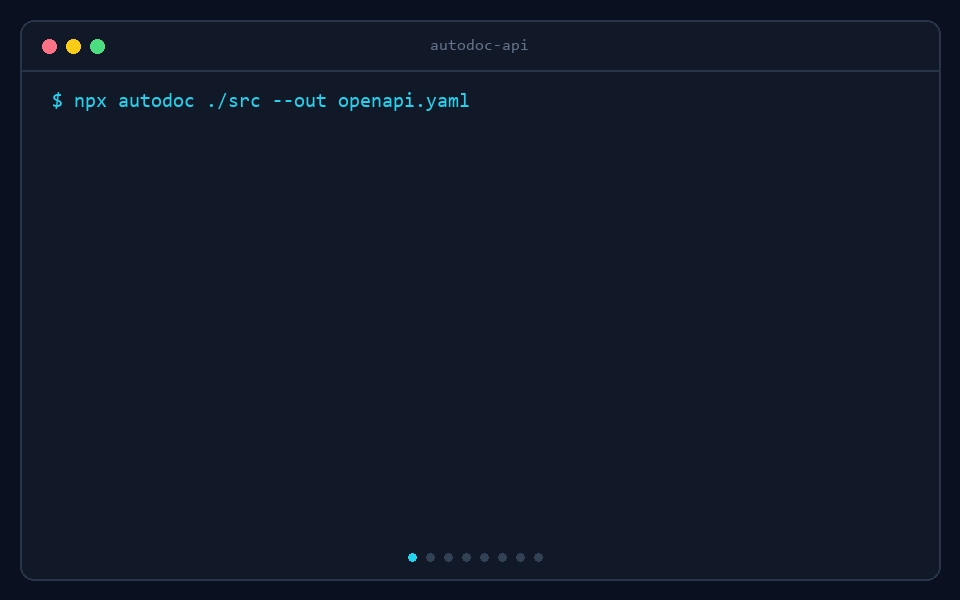

# autodoc-api

[](https://www.npmjs.com/package/autodoc-api)
[](LICENSE)
[](https://github.com/Raman0110/autodoc-api/actions/workflows/ci.yml)

**Zero-annotation OpenAPI 3.1 docs for existing Express + TypeScript APIs.**



autodoc-api reads the code you already wrote (routes, controllers, TypeScript types, Zod schemas, middleware) and generates an `openapi.json` plus interactive docs (Scalar, Swagger UI, ReDoc). No decorators, no Swagger comments, no duplicated schemas.

## Install

```bash
npm install -D autodoc-api
```

Requires Node.js 18+. Run `npm install` in your project first, so TypeScript can resolve your dependencies' types.

## Quick start

### Option 1: serve docs from your app

```ts
import express from 'express';
import { autodocMiddleware } from 'autodoc-api';

const app = express();

app.use(autodocMiddleware());   // docs at http://localhost:3000/docs

// ...your routes
```

| URL | Shows |
| --- | --- |
| `/docs` | Scalar |
| `/docs/swagger` | Swagger UI |
| `/docs/redoc` | ReDoc |
| `/docs/openapi.json` | The OpenAPI document |

The source is analyzed once, on the first request to `/docs`, then cached.

Install it as a regular dependency (`npm install autodoc-api`) if this runs in production.

### Option 2: use the CLI

```bash
npx autodoc ./src                # writes openapi.json and prints a coverage report
npx autodoc serve ./src          # docs at http://localhost:4000/docs
npx autodoc check ./src          # CI: exit 1 if coverage is too low or the spec is invalid
```

| Command | Description |
| --- | --- |
| `autodoc [dir]` / `generate` | Analyze `dir` (default `./src`) and write the spec |
| `autodoc scan [dir]` | Print the report only, write nothing |
| `autodoc serve [dir]` | Serve interactive docs and re-analyze on file changes |
| `autodoc check [dir]` | Fail the build below `--min-coverage` (default 80) |

| Flag | Description |
| --- | --- |
| `--out <file>` | Output file (default `./openapi.json`) |
| `--format <name>` | Output `json` or `yaml`; also inferred from `.yaml`/`.yml` filenames |
| `--port <n>` | Port for `serve` (default 4000) |
| `--provider <name>` | `scalar` (default), `swagger` or `redoc` |
| `--tsconfig <file>` | Use a specific `tsconfig.json` |
| `--min-coverage <n>` | Threshold for `check` |
| `--verbose` | Show the full per-endpoint checklist |

Handy `package.json` scripts:

```json
{
  "scripts": {
    "docs": "autodoc ./src --out openapi.json",
    "docs:serve": "autodoc serve ./src",
    "docs:check": "autodoc check ./src --min-coverage 80"
  }
}
```

Generate YAML either by filename or explicitly:

```bash
npx autodoc ./src --out openapi.yaml
npx autodoc ./src --format yaml
```

The development server and middleware expose both `/openapi.json` and
`/openapi.yaml`.

## Middleware options

```ts
autodocMiddleware({
  path: '/docs',            // where the docs live when mounted without a path
  provider: 'scalar',       // 'scalar' | 'swagger' | 'redoc'
  dir: './src',             // source folder to analyze
  title: 'My API docs',
  enabled: true,            // e.g. process.env.NODE_ENV !== 'production'
  live: false,              // true = re-analyze on every request (development)
  specFile: './openapi.json', // serve a pre-generated spec instead of analyzing
  tsconfig: './tsconfig.json',
});
```

You can also mount it yourself: `app.use('/api/docs', autodocMiddleware())`.

**Production:** the middleware needs your TypeScript source at runtime. If you deploy only `dist/`, generate the spec at build time and serve that file:

```bash
autodoc ./src --out openapi.json
```
```ts
app.use(autodocMiddleware({ specFile: './openapi.json' }));
```

The docs are public once mounted. Put your own auth middleware in front to protect them: `app.use('/docs', requireAdmin, autodocMiddleware())`. If you use `helmet`, allow `cdn.jsdelivr.net` in your Content-Security-Policy (the UI scripts load from there).

## What it detects

| Source | Result |
| --- | --- |
| Express routes | `get/post/put/patch/delete/options/head`, `router.route().get().post()`, routers mounted with `app.use('/api', router)` (also across files), routers returned from functions |
| Paths | `/users/:id` becomes `/users/{id}` with a path parameter |
| Controllers | Named functions, inline handlers, `controller.method`, class-property arrow functions, `asyncHandler(fn)` wrappers |
| Zod | `validate(schema)` middleware, `schema.parse(req.body)` / `safeParse` inside the controller, `req.query` and `req.params` schemas, constraints, optional / nullable / default, enums, unions, `extend` / `merge` / `pick` / `omit` / `partial` |
| TypeScript types | `Request<Params, ResBody, ReqBody, Query>`, `Response<T>`, interfaces, aliases, enums, unions, generics, `Promise<T>`, `Record`, `Date` |
| Responses | `res.status(201).json(...)`, `res.json(...)`, `res.sendStatus(...)`, `res.status(204).send()`, `res.cookie(...).json(...)`; the body type comes from the expression's TypeScript type |
| Request body from a service call | `const dto = req.body; service.create(dto)` uses the type of the service method's parameter |
| Query / header inference | `req.query.page`, `const { q } = req.query`, `req.get('x-id')` (lower confidence) |
| Auth | Middleware named like `authenticate`, `requireAuth`, `protect` marks the route `bearerAuth` (reported as uncertain unless configured) |
| Metadata | JSDoc on a controller (first paragraph is the summary), or `docs()` |

Plain `.js` files are analyzed too, with less type information.

## Getting accurate docs

AutoDoc can only report what your code makes visible. The more your code is typed, the better the docs. Where it can't tell, it says so (a warning and a coverage score) instead of guessing.

### Routes

```ts
// ✅ Static paths, named routers, mounted with a literal prefix
const router = Router();
router.get('/:id', getUser);
export default router;

app.use('/api/users', router);

// ❌ Paths that only exist at runtime are skipped
routes.forEach((r) => router.get(buildPath(r), handler));
```

### Request bodies, best to worst

```ts
// 1. A Zod schema (exact, with constraints). Either style works:
router.post('/users', validate(CreateUserSchema), createUser);

const body = CreateUserSchema.parse(req.body);      // inside the controller

// 2. A typed Request
async function createUser(req: Request<{}, UserDto, CreateUserDto>, res: Response<UserDto>) {}

// 3. Passing the body to a typed function (the parameter type is used)
const dto = req.body;
await userService.create(dto);                       // create(dto: CreateUserDto)

// 4. Destructuring only: field names, no types (low confidence)
const { name, email } = req.body;
```

Use named schema constants (`const CreateUserSchema = z.object(...)`). They become reusable `$ref` components instead of repeated inline objects.

### Responses

```ts
// ✅ Literal status codes and typed values
async function getUser(req: Request<{ id: string }>, res: Response<UserDto | ErrorDto>) {
  const user = await service.find(req.params.id);   // returns Promise<UserDto | null>
  if (!user) return res.status(404).json({ message: 'User not found' });
  return res.status(200).json(user);
}
```

- Give service and repository methods **explicit return types**, and avoid `any`. A value typed `any` produces an empty schema.
- If you map results (`serialize(row)`), type the function's parameter and return value. `(row: any) => ({ id: row.id })` documents field names but not their types.
- Respond with `res.status(n).json(...)` directly in the handler. Helper calls like `sendSuccess(res, 200, data)` are not followed.
- Use constant status codes. `res.status(code)` with a variable is assumed to be 200 with a warning.
- Declare `Response<T>` with a union for success and error bodies (`UserDto | ErrorDto`); each status code gets the type that is actually returned with it.

### Authentication

Middleware with a conventional name is detected automatically but flagged as uncertain. List your own names in `autodoc.config.json` to make it certain:

```json
{ "authMiddleware": ["checkSession", "verifyClerkToken"] }
```

### Descriptions

```ts
/**
 * List users
 *
 * Returns a page of users, optionally filtered by a search term.
 */
export async function listUsers(req: Request, res: Response) {}

// For things that can't be inferred (extra error responses, tags):
import { docs } from 'autodoc-api';

router.post('/users', validate(CreateUserSchema),
  docs(createUser, {
    summary: 'Create a new user',
    tags: ['Users'],
    responses: { 409: 'Email already registered' },
  }));
```

`docs()` returns the handler unchanged and is read statically, so it has no runtime cost.

## Coverage report

Each endpoint gets a score and a checklist, so you can see what to improve:

```
PATCH /api/users/:id
  ✓ route detected
  ✓ request schema detected
  ⚠ response type could not be resolved
  ⚠ authentication method uncertain (inferred from middleware name)
```

The generated spec also carries `x-autodoc` (coverage, confidence, source location) on every operation.

## Configuration

Optional `autodoc.config.json` in your project root:

```json
{
  "title": "Acme API",
  "version": "2.1.0",
  "description": "Public API for Acme",
  "servers": ["https://api.acme.com"],
  "authMiddleware": ["checkSession"],
  "docs": { "provider": "scalar" },
  "minCoverage": 85,
  "exclude": ["legacy"]
}
```

`title`, `version` and `description` default to your `package.json` values.

## Programmatic API

```ts
import { analyzeProject, generateOpenApi, validateOpenApi, coverageReport } from 'autodoc-api';
import { writeFileSync } from 'node:fs';

const { model, project } = analyzeProject('./src');
const spec = generateOpenApi(model, project.config, project.packageJson);

console.log(validateOpenApi(spec));          // [] when the structure is valid
console.log(coverageReport(model).overall);  // 0-100
writeFileSync('openapi.json', JSON.stringify(spec, null, 2));
```

Keep scripts like this outside `./src`, so they are not scanned or shipped in your build.

## Limitations

- Express only (4 and 5). Fastify, Koa and Hono are not supported yet.
- Zod is the only supported validation library so far. Joi, Valibot, Yup, TypeBox and express-validator are not detected.
- Static analysis: routes registered dynamically, response helpers, and values typed `any` can't be resolved.
- Authentication is inferred from middleware names only.
- Generated documents are validated against the official OpenAPI 3.1 JSON Schema, followed by semantic checks for references, operation IDs, parameters and security schemes.

## Contributing

See [CONTRIBUTING.md](CONTRIBUTING.md) for development and pull-request guidance. Please report suspected vulnerabilities according to [SECURITY.md](SECURITY.md).

```bash
git clone https://github.com/Raman0110/autodoc-api.git
cd autodoc-api
npm install
npm test
```

Bug reports are most useful with the route definition and the controller that was analyzed wrongly, plus the output of `npx autodoc scan ./src --verbose`.

## License

[MIT](LICENSE)
